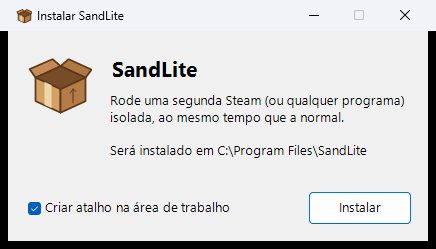
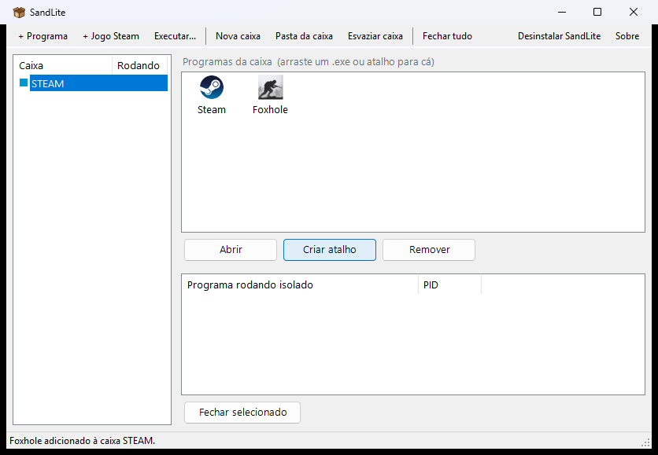
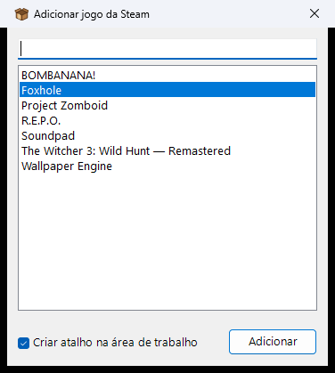
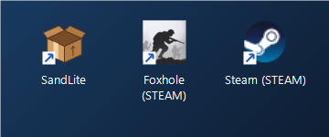

<div align="center">


# SandLite

**Rode duas (ou mais) Steams ao mesmo tempo no mesmo PC, com atalho de um clique.**

Leve, simples e sem aquele monte de opções que ninguém usa.

[](https://github.com/FabricioRizzz/SandLite/releases/latest)


</div>

---

## O que ele faz

- Abre uma **segunda Steam isolada**, com outra conta, junto com a sua Steam normal.
- Abre **o mesmo jogo duas vezes**, um em cada conta.
- Cria **atalho na área de trabalho** que já abre a Steam isolada e inicia o jogo.
- Os jogos **não são baixados de novo**: a Steam isolada usa a mesma instalação.
- Funciona com qualquer programa, não só a Steam.

---

## Como usar

### 1. Instale

Baixe o **[SandLite-Instalador.exe](https://github.com/FabricioRizzz/SandLite/releases/latest)**, abra e clique em **Instalar**.
O Windows pede permissão de administrador uma vez, para instalar o motor de isolamento.



### 2. Abra o SandLite

A caixa **STEAM** já vem criada, com a Steam dentro. Dois cliques em **Steam** abrem a Steam isolada.
Na primeira vez, faça login com a sua **segunda conta**.



### 3. Adicione um jogo

Clique em **+ Jogo Steam**, escolha o jogo e clique em **Adicionar**.
Com a opção **Criar atalho na área de trabalho** marcada, o atalho já é criado.



### 4. Jogue com um clique

O atalho abre a Steam isolada e já inicia o jogo, sem precisar abrir o SandLite.



---

## Dicas

| Quero... | Faça |
|---|---|
| Uma terceira (ou quarta...) conta | **Nova caixa** → uma Steam por caixa |
| Abrir outro programa isolado | **+ Programa** ou arraste o `.exe` para a janela |
| Fechar só o que está isolado | **Fechar tudo** (a Steam normal continua aberta) |
| Apagar o login da conta isolada | **Esvaziar caixa** |
| Acesso rápido | Feche a janela: o SandLite fica perto do relógio, botão direito abre seus jogos |
| Remover tudo | **Desinstalar SandLite** no app ou em *Configurações > Aplicativos* |

> **Atenção:** alguns jogos com anti-cheat (EasyAntiCheat, BattlEye) podem não abrir dentro de uma caixa.
> Respeite as regras de cada jogo sobre múltiplas contas.

---

## Compilar

Não precisa instalar nada: o compilador C# já vem no Windows.

```powershell
powershell -ExecutionPolicy Bypass -File compilar.ps1
```

O instalador sai em `saida\SandLite-Instalador.exe`.

| Arquivo | O que é |
|---|---|
| `SandLite.cs` | O aplicativo |
| `Instalador.cs` | O instalador (leva o app e o motor dentro) |
| `motor\` | Motor de isolamento |
| `ferramentas\gerar_icone.ps1` | Gera o ícone da caixa |

---

## Créditos

**SandLite** foi criado por **[Fabricio Riz](https://github.com/FabricioRizzz)**.

O isolamento é feito pelo motor do **[Sandboxie](https://github.com/sandboxie-plus/Sandboxie)**, projeto de código aberto de
**David Xanatos** ([xanasoft.com](https://xanasoft.com)) e **Sandboxie Holdings, LLC**.
Os arquivos da pasta `motor\` são distribuídos **sem modificações**, sob a licença GNU GPL v3.
Todo o mérito do isolamento é deles. 💛

O SandLite não é afiliado ao projeto Sandboxie nem à Valve. Steam é marca da Valve Corporation.

## Licença

[GNU GPL v3](LICENSE)
